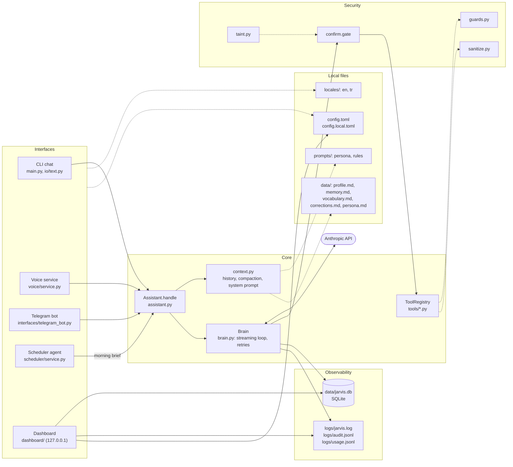

# Architecture

Jarvis is one Python package (`src/jarvis/`). The model is Claude on the Anthropic API; everything else
(tools, memory, logs, voice, the scheduler, the Telegram bot, the dashboard) runs on your Mac. Every
interface drives the same `Assistant`, and the `Assistant` never knows which interface is talking to it.

## One turn

1. An interface reads the input and calls `Assistant.handle(text, sink)`. The `sink` is an
   `io.base.OutputSink`: it receives the streamed text, notices and confirmation requests. Telegram passes
   forwarded messages as `untrusted` content; a spoken request is marked as spoken.
2. The Assistant cleans the input (`sanitize.user_input`), opens a turn row in SQLite and, when the
   conversation is longer than `context.compact_after_tokens`, summarizes older turns (`context.compact`).
3. It builds the system prompt and appends the user message to the history.
4. `Brain.run_turn` calls the Messages API with streaming. Text goes to the sink as it arrives. For every
   `tool_use` block the Brain looks the tool up in the registry, validates the arguments with the tool's
   Pydantic model, asks `confirm.gate`, runs the tool, cleans the result and sends it back. The loop stops
   when the model answers without a tool call or after `loop.max_tool_iterations`. Connection errors,
   429 and 5xx are retried with backoff (`loop.api_max_attempts`).
5. The reply is the text after the last tool block (`io.base.compose_reply`). The turn, its messages,
   tool calls, API calls, timings and cost are written to SQLite and the logs. After a quiet gap the
   memory pass (`memory_pass.py`) proposes facts the conversation missed.

## Prompt layout and caching

`context.build_system` builds the request with the stable parts first: the tool definitions (sorted by
name, `ToolRegistry.api_tools`), then `<persona>`, `<rules>`, `<user_profile>` and `<memory>`. Cache
breakpoints sit after the rules, the profile and the memory; the Brain adds automatic caching for the
growing conversation tail. The profile block ends with the fallback language and a note on the channel
(cli, telegram or voice). Memory is re-read every turn. When the system prompt changes, old thinking
blocks are dropped from the history so the API accepts the request. `observability/composition.py`
records how many tokens each part used.

## Tools, risk levels and taint

Each capability is one module in `src/jarvis/tools/`. A tool is a `Tool` subclass with a Pydantic input
model, a `RiskLevel` (`SAFE` runs, `CONFIRM` asks first, `BLOCKED` never runs) and a `taints` flag.
`ToolRegistry.discover` imports every module and registers each tool whose `available()` returns true,
so an integration that is not set up is not offered to the model. The Telegram bot gets a subset
(`telegram.remote_allowed_tools`). The `delegate` tool runs a second model with its own restricted tool
loop. `web_search` is Anthropic's server-side search tool. See
[src/jarvis/tools/README.md](../src/jarvis/tools/README.md).

## Security

Security lives in code, not in the prompt (`src/jarvis/security/`):

- `confirm.gate` decides per call: `BLOCKED` raises, `CONFIRM` asks, and a `SAFE` tool can still ask in a
  tainted turn (`Tool.tainted_confirm_reason`).
- `taint.py`: a turn is tainted as soon as a tool with `taints = True` returns content (email, web pages,
  the clipboard). That content reaches the model wrapped in `<untrusted source="...">`.
- `guards.py`: `PathGuard` (allowed roots, denied paths, never `data/` or `logs/`), `ShellGuard` (denylist,
  argv only), `UrlGuard` with SSRF blocking, AppleScript argument checks, email and header validation.
- `sanitize.py`: control and invisible characters removed before the model or the terminal sees text,
  HTML converted to text.
- Secrets live in the macOS Keychain (`utils/secrets.py`, service `jarvis`); the log formatters mask them.
- The Telegram bot answers one allowlisted user, with a kill switch and a rate limit; the dashboard
  listens on 127.0.0.1 only, with a one-time token, a session cookie, CSRF and Host checks and an idle lock.

See [src/jarvis/security/README.md](../src/jarvis/security/README.md) and [SECURITY.md](../SECURITY.md).

## Observability

- `data/jarvis.db` (SQLite, WAL, versioned migrations in `observability/db.py`): sessions, turns,
  messages, tool calls, API calls, timings, timers, presence and network history, turn summaries and
  voice events, with full-text search over the turns.
- `logs/jarvis.log` (application log), `logs/audit.jsonl` (one line per tool call: risk, taint, decision),
  `logs/usage.jsonl` (one line per API call). Every line carries the session and turn id.
- `observability/usage.py` computes the cost and tracks it against `budget.daily_budget_usd` (informational, never a stop).
- `jarvis stats`, `jarvis usage`, `jarvis sessions`, `jarvis export` read the database; `jarvis doctor`
  runs the health checks (`observability/health.py` plus a `health_checks` function in each integration).

## Background services

Three launchd user agents, each with `KeepAlive`, run the installed `jarvis` command:

| Agent | Command | Module |
| --- | --- | --- |
| `com.jarvis-assistant.scheduler` | `jarvis scheduler run` | `scheduler/launchd.py` |
| `com.jarvis-assistant.telegram` | `jarvis telegram run` | `interfaces/telegram_launchd.py` |
| `com.jarvis-assistant.voice` | `jarvis voice run` | `voice/launchd.py` |

`JARVIS_LAUNCHD_PREFIX` changes the label prefix. `jarvis services status` shows them and
`jarvis services reinstall` rewrites and reloads them. The scheduler fires timers and alarms, runs the
presence scan, the optional internet checks and the morning brief, and re-reads the config when it changes
(`scheduler/config_watch.py`). The voice and Telegram agents read the config when they start. The
dashboard is not an agent: it runs only while `jarvis dashboard` runs in a terminal.

## Languages

Jarvis speaks English and Turkish. `general.language` is the main language. It picks
`prompts/persona.<language>.md` and `prompts/rules.<language>.md` (after the shared `prompts/rules.md`),
the profile template, notifications and the voice defaults. Replies follow the language of the user's
latest message. Every user-facing string comes from `src/jarvis/locales/<language>/*.toml` through
`jarvis.i18n.t`. Commands stay English in every language, and so do log lines, tool results for the
model, the dashboard and `jarvis doctor`. See [src/jarvis/locales/README.md](../src/jarvis/locales/README.md)
and [src/jarvis/prompts/README.md](../src/jarvis/prompts/README.md).
